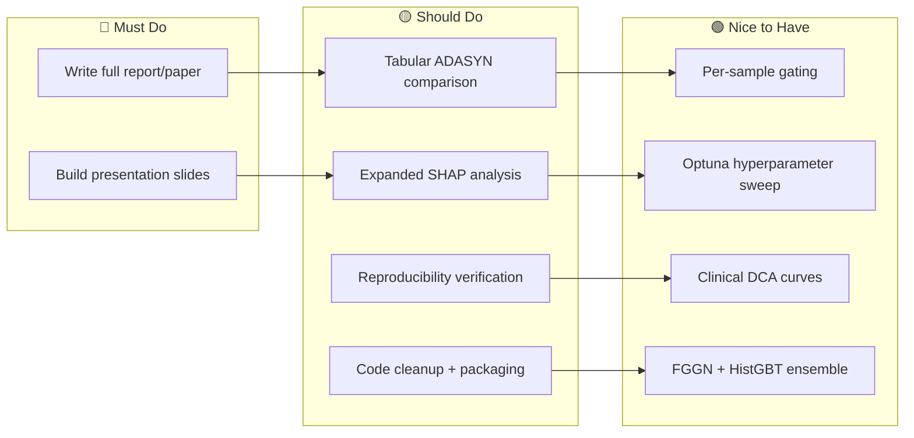

# Professor Doubts, Remaining Work & Improvements

## Part A — Questions / Doubts to Ask Your Professor

### 🔬 About the Paper & Reproduction

1. **Metric inconsistency in the original paper:**
   Our audit found that the paper's reported 96% precision + 87.8% recall at 9.42% prevalence mathematically requires ~98.5% accuracy, but they report 91.7%. Should we treat this as a typographical error, a different evaluation protocol (e.g., balanced test set), or flag it as a limitation of the original study?

2. **No source code from the original authors:**
   The paper doesn't provide executable code. We've built a *structural reimplementation* from their architecture descriptions. Is it acceptable to label our reproduction as "architecture-faithful" rather than "exact", and focus our contribution on the methodological audit + FGGN extension?

3. **Duplicate rows in the dataset:**
   We found 23,899 duplicate rows in the 253,680-row BRFSS 2015 CSV. The original paper doesn't mention deduplication. Should we (a) keep duplicates for comparability with the paper, (b) remove them and report the impact, or (c) run both and compare? *(Currently we kept them for comparability.)*

### 📊 About Methodology & Evaluation

4. **ADASYN on discrete/binary survey features:**
   ADASYN interpolates between neighbors, which creates fractional values for binary features (e.g., 0.63 for Smoker). We found ADASYN actually *hurts* performance vs. class-weighting on this dataset. Is it sufficient to present this as an ablation finding, or should we attempt post-hoc rounding of synthetic samples?

5. **Threshold selection protocol:**
   We select the operating threshold on the validation set (constraining recall ≥ 80%) and freeze it before test evaluation. Is this the protocol you'd recommend, or should we also report results at the natural 0.50 threshold and at equal-error-rate?

6. **Statistical significance testing:**
   We used the Nadeau–Bengio corrected paired t-test across 5 seeds. Is this sufficient for the course, or would you prefer a non-parametric test (Wilcoxon signed-rank) or a bootstrap confidence interval approach as well?

7. **Negative result — gating doesn't help:**
   Our main finding is that FGGN's *learned* softmax gating is statistically indistinguishable from *uniform* group pooling (p = 0.448). The grouping structure itself helps (both beat EnsCVDD-Net, p = 0.001), but the gating doesn't add value. Should we reframe the contribution around "domain-grouped architectures" rather than "learned gating"?

### 📝 About Report & Submission

8. **Report format and length:**
   Our outline has 12 sections (abstract through limitations). Is there a page limit or required template (IEEE, ACM, course-specific)? Should we include the full ablation matrix in the main body or move it to an appendix?

9. **Reproducibility artifact:**
   Should we submit a runnable code package with `requirements.txt`, seed-locked configs, and a single `make reproduce` command? Or is the report + selected code snippets sufficient?

10. **Negative results framing:**
    The literature suggests tree ensembles outperform deep learning on tabular data (Grinsztajn et al., 2022). Our HistGBT beating all neural models is consistent with this. Is it acceptable for a course project to have a "confirming existing knowledge + explaining why" contribution rather than a novel SOTA result?

---

## Part B — Remaining Work Divided into 4 Parts

### Part 1: Report & Writing (Highest Priority)

> [!IMPORTANT]
> The `report/outline.md` blueprint exists with all numbers, but needs expansion into a proper paper.

| Task | Status | Effort |
|------|--------|--------|
| Expand outline into full LaTeX/Word paper (~8-12 pages) | 🔴 Not started | ~6-8 hrs |
| Write Abstract (250 words, quantitative) | 🔴 Not started | ~30 min |
| Write Introduction with clear problem statement + contribution list | 🔴 Not started | ~1.5 hrs |
| Write Related Work section using `related_work_matrix.md` | 🔴 Not started | ~1.5 hrs |
| Write Methodology section (data pipeline, models, FGGN architecture) | 🔴 Not started | ~2 hrs |
| Write Results section with tables from robustness study | 🔴 Not started | ~1.5 hrs |
| Write Discussion — why gating didn't help, ADASYN findings, calibration insights | 🔴 Not started | ~1.5 hrs |
| Write Limitations & Future Work | 🔴 Not started | ~30 min |
| Proofread, format references, add figure captions | 🔴 Not started | ~1 hr |

### Part 2: Presentation Materials

| Task | Status | Effort |
|------|--------|--------|
| Create slide outline (12-15 slides) | 🔴 Not started | ~1 hr |
| Build slides (Problem → Method → Key Results → Demo → Conclusion) | 🔴 Not started | ~3-4 hrs |
| Prepare 2-min "elevator pitch" summary | 🔴 Not started | ~30 min |
| Anticipate Q&A — prepare backup slides on ablations, calibration, SHAP | 🔴 Not started | ~1 hr |

### Part 3: Final Experiments & Polishing

| Task | Status | Effort |
|------|--------|--------|
| Run tabular experiments with `--resampling adasyn` for direct comparison | 🟡 Partially done | ~30 min |
| Expand SHAP analysis — per-model, per-group, interaction plots | 🟡 Basic done | ~1-2 hrs |
| Generate final publication-quality figures (increase DPI, consistent styling) | 🟡 Mostly done | ~1 hr |
| End-to-end reproducibility test (fresh venv, run all from scratch) | 🔴 Not started | ~1-2 hrs |
| Create `SHA256SUMS.txt` for all deliverable artifacts | 🔴 Not started | ~15 min |

### Part 4: Code Cleanup & Submission Packaging

| Task | Status | Effort |
|------|--------|--------|
| Add docstrings/comments to any under-documented functions | 🟡 Mostly done | ~1 hr |
| Update `README.md` with final instructions and results summary | 🟡 Exists | ~30 min |
| Create `Makefile` or single `reproduce.sh` for one-command reproduction | 🔴 Not started | ~1 hr |
| Archive final artifact directory with version tag | 🔴 Not started | ~15 min |
| Clean up any debug/scratch files | 🔴 Not started | ~15 min |
| Final git commit with tagged release | 🟡 Single commit exists | ~15 min |

---

## Part C — Improvements to Further Cement FGGN & Supporting Work

### 🏗️ Architectural Improvements for FGGN

1. **Attention-based gating instead of simple softmax:**
   Replace the single linear → softmax gate with a multi-head self-attention mechanism across feature groups. Each group's representation attends to other groups before weighting, allowing *conditional* gating (e.g., lifestyle features weighted differently when clinical history indicates high risk).

2. **Per-sample gating (instance-dependent):**
   Currently FGGN learns *global* gate weights (same for every patient). Make gating *instance-dependent* — the gate network takes the concatenated group embeddings as input and outputs per-sample weights. This lets the model emphasize different feature groups for different patient profiles.

3. **Residual connections within group sub-networks:**
   Add skip connections in each group's MLP to improve gradient flow, especially if you deepen the sub-networks to 3-4 layers.

4. **Group-wise dropout / DropGroup regularization:**
   During training, randomly zero out entire feature groups (like DropBlock for CNNs). This forces the model to not over-rely on a single group and may improve generalization.

### 📈 Experimental Improvements

5. **Hyperparameter sweep (Optuna):**
   The current FGGN uses manually-set hyperparameters. A proper Bayesian hyperparameter search (learning rate, hidden dims per group, dropout rate, weight decay) using Optuna on the validation set could unlock better performance. Report the search space and best config.

6. **Learning rate scheduling:**
   Add cosine annealing or ReduceLROnPlateau. The current flat learning rate may cause the model to converge sub-optimally.

7. **Cross-validation instead of single split:**
   While 5-seed robustness is good, stratified 5-fold or 10-fold CV would give tighter confidence intervals and is more standard in the medical ML literature.

8. **Feature engineering for group boundaries:**
   The current 4 groups are manually defined. Try learned grouping (e.g., cluster features by mutual information or correlation, then let the network learn group assignments via a soft clustering layer).

### 📊 Analysis & Reporting Improvements

9. **Calibration-aware comparison:**
   Report post-calibration metrics as primary (not just an appendix). Since uncalibrated Brier scores are worse than baseline due to class-weight logit shift, showing isotonic-calibrated results as the "fair" comparison strengthens the paper.

10. **Clinical decision curve analysis (DCA):**
    Plot net benefit across threshold probabilities. This is standard in clinical prediction papers and shows at which risk thresholds each model is clinically useful vs. "treat-all" or "treat-none".

11. **Feature importance agreement across methods:**
    Compare SHAP rankings vs. PBCC rankings vs. FGGN gate weights vs. permutation importance. Agreement/disagreement across methods strengthens or qualifies the explainability story.

12. **Deeper subgroup fairness analysis:**
    Beyond performance-by-demographic, compute equalized odds and calibration-by-group. Flag if the model is well-calibrated for older adults but poorly calibrated for younger ones (likely given prevalence differences).

### 🔒 Robustness & Validity

13. **External validation dataset:**
    If the BRFSS 2021 or Cleveland Heart Disease dataset is accessible, a simple transfer test (train on BRFSS 2015, evaluate on a different year/source) would dramatically strengthen the paper's validity claims.

14. **Adversarial / perturbation robustness:**
    Randomly flip 5-10% of binary features at test time and measure degradation. This simulates noisy self-reported survey data and tests practical robustness.

15. **Ensemble of FGGN + HistGBT:**
    Since one is neural and the other is tree-based, their errors may be decorrelated. A simple probability average could outperform either alone — and this would give FGGN a clear role even if it doesn't beat HistGBT solo.

---

## Summary Priority Matrix

> [!TIP]
> **Recommended priority order:** Report writing → Presentation → Final experiments → Code packaging. The "nice to have" improvements are excellent talking points for the Future Work section even if you don't implement them all.
