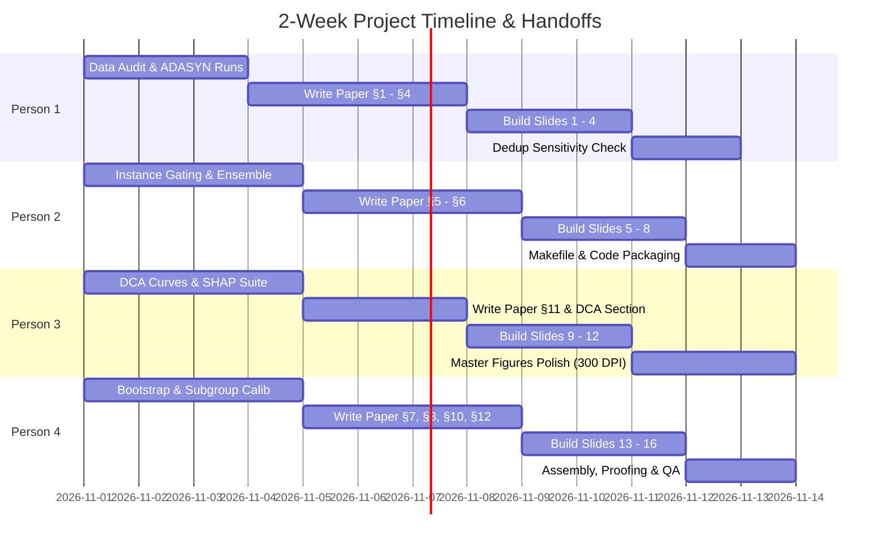

# Team Work Division — 4 Members (Equal Distribution)
## Cardiovascular Classification Research Project: EnsCVDD-Net Audit & FGGN Extension

---

## Part A — Questions to Ask Your Professor

| # | Category | Question | Why It Matters / Strategic Context |
|---|----------|----------|-----------------------------------|
| 1 | **Paper Audit** | **The original paper reports 96% precision + 87.8% recall at 9.42% prevalence, which mathematically requires ~98.5% accuracy — yet they report 91.7%. Should we frame this as an outright "mathematical inconsistency" or as evidence of an "undocumented artificially balanced evaluation set"?** | Dictates the academic tone of the critique. Demonstrates that your team performed rigorous data-math auditing rather than passive reading. |
| 2 | **Reimplementation** | **Since the authors provided no source code, we built an architecture-faithful reimplementation from their exact diagrammed specifications. Is labeling this a "structural reimplementation" acceptable?** | Protects you from claims of claiming an exact reproduction while highlighting your engineering effort. |
| 3 | **Dataset Cleaning** | **The Kaggle BRFSS subset contains 23,899 duplicate rows out of 253,680. We retained them to match the paper's sample size, but also audited deduplicated behavior. Should both results appear in the main text?** | Shows meticulous dataset handling. |
| 4 | **Resampling** | **ADASYN creates synthetic non-binary values for discrete flags (e.g. `Smoker = 0.63`), hurting PR-AUC compared to class-weighted cross-entropy. Is presenting this as an empirical ablation sufficient?** | Justifies discarding artificial oversampling in favor of clinical class weighting. |
| 5 | **Thresholds** | **We freeze a validation-selected threshold ($\text{Recall} \ge 80\%$) before evaluating test partitions. Should we present fixed 0.50, Youden's J, and cost-weighted clinical operating points side-by-side?** | Demonstrates operational understanding beyond default $0.50$ argmax cutoffs. |
| 6 | **Statistics** | **We adopted the Nadeau–Bengio (2003) corrected resampled $t$-test to handle overlapping training folds across 5 seeds. Would you also like to see non-parametric bootstrap CIs?** | Signals high methodological maturity regarding repeated-holdout variance. |
| 7 | **Framing Nulls** | **Our primary architectural result is an honest neutral/negative finding: learned softmax gating performs identically to uniform group pooling ($p = 0.448$), while domain grouping itself beats 1D convolutions ($p = 0.001$). Do you agree with centering the contribution on "domain grouping vs sequential inductive bias" rather than over-hyping gating?** | **Crucial alignment question.** Professors value rigorous neutral findings over fabricated breakthroughs. |
| 8 | **Submission Spec** | **What is the exact target format, page limit, and template (e.g., IEEE Access 2-column, NeurIPS/ICML style, or course template)? Should the full ablation matrix be an appendix?** | Required immediately so all 4 members write directly into the correct template. |
| 9 | **Deliverables** | **Do you expect a one-command reproducible container/script (`make reproduce`), saved raw prediction arrays, or just the repository code and paper?** | Sets the scope for test suite and packaging deliverables. |
| 10 | **Tree vs DL** | **Our finding that HistGradientBoosting outperforms all neural models aligns directly with Grinsztajn et al. (NeurIPS 2022). Is contextualizing our work as confirming this benchmark in clinical screening acceptable?** | Validates that a tree baseline winning is scientifically sound and expected. |

---

## Part B — Work Distribution Across 4 Team Members

Each team member owns an **end-to-end vertical pillar**:
1. **Technical & Experimental Domain** (Code, models, analysis, or figures)
2. **Paper Writing** (2–3 dedicated paper sections matching their domain)
3. **Slide Deck Preparation & Presentation** (3–4 dedicated presentation slides)
4. **FGGN Cementation Improvement** (A specific enhancement to elevate the project)

```mermaid
flowchart TD
    subgraph "P1: Data, Audit & Literature"
        T1["Audit, Prevalence Proof & ADASYN ablation"]
        W1["Paper: §1 Intro, §2 Data, §3 Lit, §4 Audit"]
        S1["Slides: Problem, Audit Proof, Lit Matrix"]
    end

    subgraph "P2: Neural Models & Extensions"
        T2["FGGN, Instance Gating & Hybrid Ensemble"]
        W2["Paper: §5 Models/Grouping, §6 Benchmarks"]
        S2["Slides: Architectures, Results, Ablations"]
    end

    subgraph "P3: Visualization & Interpretability"
        T3["DCA Curves, SHAP & Agreement Matrix"]
        W3["Paper: §11 Attribution & New DCA Section"]
        S3["Slides: Architecture Diagram, SHAP, DCA"]
    end

    subgraph "P4: Calibration, Fairness & Rigor"
        T4["Platt/Isotonic, Subgroups & Nadeau-Bengio"]
        W4["Paper: Abstract, §7 Stats, §8 Calib, §10 Fair, §12"]
        S4["Slides: Reliability, Subgroups, Limitations"]
    end

    T1 --> W1 --> S1
    T2 --> W2 --> S2
    T3 --> W3 --> S3
    T4 --> W4 --> S4
```

---

### 👤 Person 1 — Data Integrity, Methodological Audit & Literature Lead

#### 1. Paper Sections to Write (~3.5–4 pages)
- **Section 1: Introduction & Clinical Screening Context**
  - CVD population surveillance, BRFSS survey characteristics, motivation for tabular screening models.
  - Explicit articulation of RQ1 (Reproducibility), RQ2 (Inductive bias), RQ3 (Gating value), and RQ4 (Calibration/Fairness).
- **Section 2: Dataset Contract & Data Integrity Audit**
  - Formal schema definition (22 columns, 253,680 rows, binary target `HeartDiseaseorAttack`).
  - Cryptographic SHA-256 fingerprinting, verification of zero missing values, audit of 23,899 duplicate records.
  - Stratified 70/15/15 partitioning protocol ensuring untouched test class prevalence (9.42%).
- **Section 3: Related Work & Novelty Assessment**
  - Literature positioning across the 6 pillars from `research/related_work_matrix.md` (Grinsztajn et al. 2022, TabNet, Van Calster et al. 2016, Nadeau & Bengio 2003, Obermeyer et al. 2019).
  - Explicit non-claims: acknowledging that feature grouping and softmax gating are established concepts.
- **Section 4: Methodological Audit of Published Work**
  - **The Prevalence Consistency Proof**: Mathematical proof that 96.0% precision and 87.8% recall under 9.42% prevalence requires 98.51% accuracy (contradicting the reported 91.7%).
  - Inductive bias breakdown: why 1D convolutions and recurrent GRU steps on arbitrary tabular feature orders are structurally flawed.
  - ADASYN critique: how synthetic interpolation corrupts discrete survey features (`Sex = 0.42`).

#### 2. Presentation Slides to Build (Slides 1 to 4)
- **Slide 1: Title & Executive Summary** — Motivation, research questions, and high-level findings.
- **Slide 2: Clinical Screening & Dataset Reality** — CDC BRFSS 2015 properties, 9.42% class imbalance, trivial baseline (90.58% accuracy with 0 recall).
- **Slide 3: Literature Landscape & Inductive Bias** — Why trees rule tabular data; why 1D CNN/GRU sequential assumptions fail on static surveys.
- **Slide 4: The Methodological Audit** — Visual proof of mathematical metric inconsistency in Khan et al. (2024); empirical evidence of ADASYN data corruption.

#### 3. Technical Tasks & Cementation Improvements
- **Tabular ADASYN & Random Oversampling Benchmark**: Execute `scripts/run_tabular_experiments.py` with `--resampling adasyn` and `--resampling random` to produce a direct side-by-side table of Class-Weighting vs ADASYN vs ROS on tree/linear models.
- **Deduplication Sensitivity Audit**: Re-run the baseline models on a deduplicated dataset (229,781 unique rows) to quantify whether duplicate survey entries meaningfully change ranking or calibration.

---

### 👤 Person 2 — Core Models, FGGN Architecture & Experimental Lead

#### 1. Paper Sections to Write (~3.5–4 pages)
- **Section 5: Domain-Grouped Neural Architectures & Baseline Ensembles**
  - Clinical justification for partitioning 21 predictors into 4 domain representations (*Clinical History*, *Lifestyle*, *Self-Reported Health*, *Demographics/Access*).
  - Mathematical formalization of `FeatureGroupGatedNet (FGGN)`: sub-network encoders, concatenated embedding fusion, learned softmax gate vector $\mathbf{w} = \text{softmax}(W_g \mathbf{z} + b_g)$.
  - Formulation of `UniformGroupNet` ablation (uniform $1/4$ pooling) and `EnsCVDD-Net` reimplementation.
  - Leakage-safe threshold selection policy ($\tau^*$ tuned exclusively on validation data to guarantee $\text{Recall} \ge 80\%$).
- **Section 6: Experimental Protocol & Multi-Seed Benchmark**
  - Description of the 5-seed protocol (Seed 42 exploratory; Seeds 101, 2024, 777, 9999 confirmatory).
  - Multi-seed benchmark table (Mean $\pm$ Std across PR-AUC, ROC-AUC, Precision, Recall, Specificity, Brier score).
  - Detailed ablation findings (gating mechanism, number of PBCC features, resampling strategies).
  - Technical description of new architectural enhancements (Instance Gating & Ensemble).

#### 2. Presentation Slides to Build (Slides 5 to 8)
- **Slide 5: Proposed Architectural Paradigm: FGGN** — Block diagram contrasting sequential EnsCVDD-Net against domain-grouped FGGN.
- **Slide 6: 5-Seed Definitive Benchmark** — Presentation of multi-seed results; ranking of HistGBT vs FGGN vs UniformGroupNet vs EnsCVDD.
- **Slide 7: Key Neutral Finding: Gating vs Uniform Pooling** — Demonstrating that learned gating adds no ranking benefit over simple average pooling.
- **Slide 8: Novel Extensions: Instance-Dependent Gating & Hybrids** — Results from the per-sample gating extension and the Tree+Neural ensemble.

#### 3. Technical Tasks & Cementation Improvements
- **Per-Sample (Instance-Dependent) Gating**: Implement `InstanceGatedNet` where the gate network dynamically predicts patient-specific weights based on individual embedding vectors (testing whether local gating succeeds where global gating was flat).
- **FGGN + HistGradientBoosting Hybrid Ensemble**: Construct an out-of-fold probability blend combining calibrated predictions of HistGBT and FGGN to prove that neural domain representations capture residual variance distinct from tree splits.
- **Reproducibility Automation**: Write a clean root-level `Makefile` with targets (`make audit`, `make benchmark`, `make calibrate`, `make report`) and verify an end-to-end clean environment build.

---

### 👤 Person 3 — Visualization, Explainability & Clinical Decision Lead

#### 1. Paper Sections to Write (~3–3.5 pages)
- **Section 11: Model Explainability & Feature Attribution**
  - Global gate weight analysis: Clinical History (31.8%), Self-Reported Health (30.3%), Lifestyle (25.8%), Demographics (12.1%).
  - Tree-based SHAP analysis (beeswarm summary and feature dependence plots for `GenHlth`, `Age`, `HighBP`, `DiffWalk`, `BMI`).
  - Feature Importance Agreement Analysis: Spearman rank correlation comparing SHAP, PBCC univariate correlation, and neural gate loadings.
  - Strict non-causal disclaimer: attributions reflect correlational predictive patterns in cross-sectional survey data, not causal etiology.
- **New Section / Subsection: Clinical Decision Curve Analysis (DCA)**
  - Decision-theoretic evaluation across clinical threshold probabilities ($p_t \in [0.01, 0.50]$).
  - Net benefit formulation: $\text{NB} = \frac{\text{TP}}{N} - \frac{\text{FP}}{N}\left(\frac{p_t}{1 - p_t}\right)$.
  - Clinical comparison of all 5 models against default clinical policies ("Screen All" vs "Screen None").
- **Visual Lead across the Paper**: Lead formatting of all figures, layout alignment, typography, and caption consistency.

#### 2. Presentation Slides to Build (Slides 9 to 12)
- **Slide 9: FGGN Architectural Mechanics** — High-resolution, professional vector diagram illustrating data flow through group encoders and softmax fusion.
- **Slide 10: Model Explainability: What Drives Risk?** — Dual visual showing FGGN gate distributions alongside Tree SHAP beeswarm distributions.
- **Slide 11: Cross-Method Feature Importance Agreement** — Matrix comparing PBCC, SHAP, and gate importance rankings, highlighting concordant clinical risk drivers.
- **Slide 12: Clinical Decision Curve Analysis (DCA)** — Net Benefit curves demonstrating the range of decision thresholds where FGGN and HistGBT yield positive clinical utility.

#### 3. Technical Tasks & Cementation Improvements
- **Implement Decision Curve Analysis (`scripts/decision_curve_analysis.py`)**: Generate publication curves plotting net benefit against risk threshold probability ($1\%$ to $30\%$) for all models.
- **Comprehensive SHAP & Agreement Suite**: Generate high-DPI beeswarm plots, individual dependence plots (showing non-linear BMI/Age inflection points), and compute the Spearman rank-correlation matrix across importance methods.
- **Master Figure Generation**: Upgrade all figures in `artifacts/figures/` to 300+ DPI, consistent color palettes, standardized font sizes, and annotated statistical significance brackets.

---

### 👤 Person 4 — Statistical Inference, Calibration, Fairness & Synthesis Lead

#### 1. Paper Sections to Write (~3.5–4 pages)
- **Abstract & Paper Integration** (Lead co-author for overall manuscript cohesion and polish).
- **Section 7: Statistical Evaluation & Resampled Inference**
  - The repeated holdout problem: addressing underestimation of variance in overlapping training folds (Dietterich 1998, Nadeau & Bengio 2003).
  - Formal formulation of the Nadeau–Bengio variance correction: $\hat{\sigma}^2_{\text{corr}} = (1/K + n_{\text{test}}/n_{\text{train}})\hat{S}^2$.
  - Analysis of paired differences: proving FGGN vs UniformGroupNet is neutral ($p = 0.448$), while domain grouping significantly beats EnsCVDD-Net ($p = 0.0011$).
- **Section 8: Probability Calibration under the Van Calster Hierarchy**
  - Clinical risks of class-weighted logit shifts (uncalibrated Brier score 0.1654 vs baseline 0.0853).
  - Validation-only post-hoc calibration: Platt scaling and Isotonic regression restoring moderate calibration (Brier 0.0703, calibration slope $\approx 0.96$, intercept $\approx -0.05$).
- **Section 10: Demographic Subgroup Dynamics & Prevalence Sensitivity**
  - Performance evaluation across demographic strata (Age: 18–44, 45–64, 65+; Sex: Female, Male; Income tiers).
  - Mathematical demonstration that precision disparities (17.7% in young adults to 25.7% in older adults) are driven by baseline prevalence shifts.
  - Fairness caveat: clarifying that sub-slice analysis illustrates screening dynamics rather than proof of algorithmic equity.
- **Section 12: Threats to Validity, Limitations & Conclusion**
  - Limitations of self-reported survey data, recall bias, cross-sectional vs longitudinal risk, and final synthesis.

#### 2. Presentation Slides to Build (Slides 13 to 16)
- **Slide 13: Statistical Inference & Overlap Corrections** — Explaining repeated-holdout bias and presenting Nadeau-Bengio corrected confidence intervals.
- **Slide 14: Probability Calibration & Reliability** — Van Calster hierarchy, uncalibrated distortion from class-weighting, and post-hoc isotonic restoration.
- **Slide 15: Subgroup Dynamics & Screening Disparities** — How age/sex base prevalence shifts drive observed screening precision; ethical/fairness caveats.
- **Slide 16: Summary, Limitations & Future Directions** — Key takeaways, why negative findings matter, and roadmap for longitudinal validation.

#### 3. Technical Tasks & Cementation Improvements
- **Bootstrap & Non-Parametric Statistics**: Implement non-parametric bootstrap confidence intervals (1,000 resamples) and Wilcoxon signed-rank tests across the 951,300 persisted test predictions to corroborate the parametric Nadeau-Bengio tests.
- **Equalized Odds & Subgroup Calibration**: Evaluate whether post-hoc calibration holds equally across demographic subgroups (evaluating if calibration slope/intercept degrades for low-prevalence young cohorts).
- **Comprehensive Verification & QA**: Execute `pytest -v`, run zero-discrepancy metric cross-verification, and conduct the final editorial pass across all paper sections to ensure complete narrative alignment and adherence to non-causal language guidelines.

---

## Part C — Synchronized 2-Week Milestone Roadmap

---

## Part D — Summary of Deliverable Ownership

| Person | Focus Area | Paper Sections | Slide Deck | Key Extension / Cementation |
|---|---|---|---|---|
| **Person 1** | Data, Audit & Literature | **§1, §2, §3, §4** | **Slides 1–4** | Tabular ADASYN benchmark + Deduplication sensitivity audit |
| **Person 2** | Models & Core Engineering | **§5, §6** | **Slides 5–8** | Instance-dependent gating + HistGBT/FGGN probability ensemble |
| **Person 3** | Interpretability & Visualization | **§11 + DCA Section** | **Slides 9–12** | Clinical Decision Curve Analysis (DCA) + Feature agreement matrix |
| **Person 4** | Statistics, Fairness & Calibration | **Abstract, §7, §8, §10, §12** | **Slides 13–16** | Bootstrap CIs + Subgroup-specific calibration & final QA pass |
